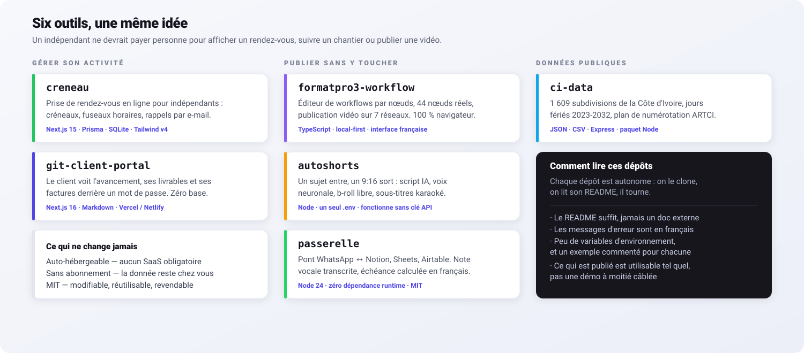

## Le catalogue

## Ce que chaque outil remplace

| Dépôt | Le problème qu'il règle | Ce qu'il remplace |
| --- | --- | --- |
| **[creneau](https://github.com/ck526438-lgtm/creneau)** | Un indépendant envoie trois allers-retours pour caler un rendez-vous | Calendly, et son abonnement par utilisateur |
| **[git-client-portal](https://github.com/ck526438-lgtm/git-client-portal)** | Le client demande « où on en est ? » toutes les semaines | Notion partagé, HoneyBook, un espace client sur-mesure |
| **[formatpro3-workflow](https://github.com/ck526438-lgtm/formatpro3-workflow)** | Les automatisations partent dans un serveur loué chez un tiers | n8n auto-hébergé, Zapier — 44 nœuds, dans l'onglet |
| **[autoshorts](https://github.com/ck526438-lgtm/autoshorts)** | Monter 20 vidéos verticales par mois | Une usine à vidéos faceless, un seul `.env` |
| **[passerelle](https://github.com/ck526438-lgtm/passerelle)** | Une note vocale WhatsApp ne finit jamais dans le bon tableur | Zapier + l'API WhatsApp Business |
| **[ci-data](https://github.com/ck526438-lgtm/ci-data)** | Les données administratives ivoiriennes n'existent nulle part en ouvert | Aucune — c'est le jeu de données lui-même |

## Les règles du studio

Elles sont les mêmes dans les six dépôts, et elles ne sont pas négociables.

- **Auto-hébergeable.** Aucun outil n'oblige à louer un service tiers pour fonctionner. Si une clé API est
  nécessaire, l'outil tourne quand même sans, ou le dit dès la première ligne du README.
- **Pas d'abonnement.** Le modèle économique de ces projets n'est pas la location de votre temps de
  cerveau. Licence MIT : vous modifiez, vous gardez, vous revendez le temps que vous voulez.
- **En français, jusqu'au bout.** Interface, messages d'erreur, documentation, dates au format
  `31 décembre 2026` et montants en euros avec l'espace qui tient à l'écran. Un outil qui vous engueule en
  anglais est un outil qu'on n'ouvre plus.
- **Le README suffit.** Pas de Notion public, pas de vidéo de démo obligatoire, pas de « contactez-nous pour
  la documentation ». On clone, on lit, ça tourne.
- **Peu de variables, et toutes documentées.** Un `.env.example` commenté, une ligne par variable, et la
  valeur à obtenir quand elle n'est pas évidente. Quand un projet en demande quinze, c'est un problème de
  conception, pas un problème de documentation.

## Par où commencer

**[git-client-portal](https://github.com/ck526438-lgtm/git-client-portal)** est le plus abouti et le plus
rapide à essayer : c'est un dépôt *template*, on le clone en un clic, on renseigne un mot de passe, on
remplace le dossier `content/`, et un client voit son avancement, ses livrables et ses factures derrière une
URL protégée. Le [schéma d'architecture](https://github.com/ck526438-lgtm/git-client-portal#comment-%C3%A7a-marche)
tient en trois blocs : des fichiers Markdown, une commande de build, un site statique.

**[formatpro3-workflow](https://github.com/ck526438-lgtm/formatpro3-workflow)** est le plus ambitieux : un
éditeur de workflows par nœuds qui tourne entièrement dans l'onglet du navigateur, sans serveur.

## État d'avancement

Un seul dépôt a un numéro de version et une release : `git-client-portal` en v1.0.0. Les cinq autres
avancent au fil de l'eau, sans jalon annoncé — ce qui est publié fonctionne, ce qui n'est pas prêt n'est
pas publié.

Les six projets acceptent les issues. Un rapport de bug utile contient le fichier de contenu concerné, la
commande lancée et le message d'erreur complet ; une demande d'évolution utile commence par le problème
rencontré, pas par la solution.

## Et ce que le studio ne fait pas

Pas de SaaS multi-tenant, pas d'application mobile, pas de traqueur d'audience, pas de compte à créer pour
lire un README. Un dépôt, un usage, une façon de l'héberger soi-même.
