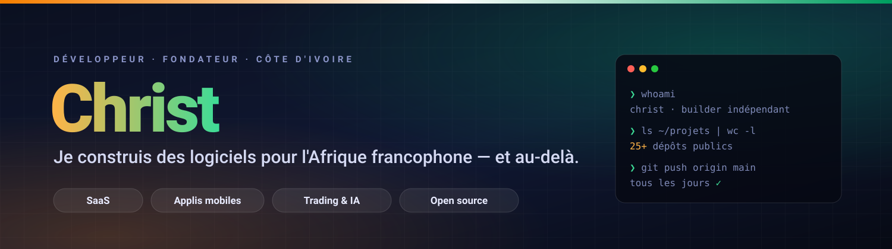
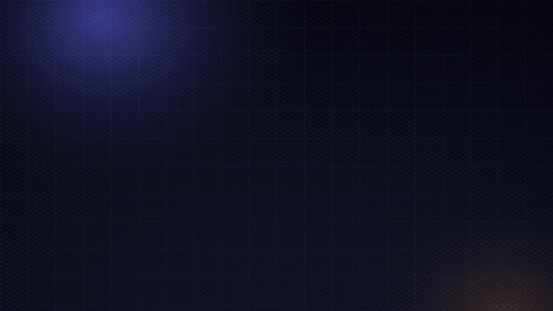

  
  
  

## Salut, moi c'est Christ 👋

Développeur et entrepreneur indépendant. Je conçois des produits complets — du backend à l'appli
qu'on installe — pensés pour les réalités de l'Afrique de l'Ouest : **WhatsApp comme canal principal,
Mobile Money pour payer, et un réseau qui coupe**. Le reste du temps, je construis des bots de trading,
des outils open source et quelques jeux.

- 🏗️ **En ce moment** : un ERP et une facturation qui se pilotent depuis WhatsApp, une appli de location
  immobilière à annonces vérifiées, et un logiciel qui lit les graphiques MT5 comme un analyste.
- 🎯 **Ma règle** : un projet n'est fini que quand on peut l'installer — `.exe`, `.apk` ou URL, pas
  « clonez et débrouillez-vous ».
- 🤝 **Ouvert à** : missions freelance (web, mobile, automatisation, bots MT5) et collaborations.

## 🧰 Stack

  
  
  
  
  
  
  
  
  
  
  
  

## ⭐ Projet phare — Git Client Portal

Un portail client piloté entièrement par un dépôt Git : le client voit l'avancement, ses livrables et ses
factures derrière une URL protégée, et vous n'avez qu'à pousser des fichiers. Dépôt *template* Next.js,
prêt à cloner.

## 🚀 Ce que je construis

### 💼 SaaS & outils pour pros

| Projet | En une ligne |
| --- | --- |
| **[git-client-portal](https://github.com/ck526438-lgtm/git-client-portal)** | Portail client 100 % Git : avancement, livrables, factures |
| **[automatisation-mail](https://github.com/ck526438-lgtm/automatisation-mail)** | Séquences d'e-mails B2B (prospection, fidélisation) avec forte délivrabilité |
| **[raze-flow](https://github.com/ck526438-lgtm/raze-flow)** | Alternative gratuite et open source à n8n, avec appli Windows |
| **[formatpro3-workflow](https://github.com/ck526438-lgtm/formatpro3-workflow)** | Éditeur de workflows par nœuds qui tourne dans le navigateur |
| **[passerelle](https://github.com/ck526438-lgtm/passerelle)** | Pont auto-hébergé entre WhatsApp et Notion, Sheets, Airtable ou une API |
| **[creneau](https://github.com/ck526438-lgtm/creneau)** | Prise de rendez-vous pour indépendants et TPE |
| **[seeka-english-club-manager](https://github.com/ck526438-lgtm/seeka-english-club-manager)** | Gestion du Club d'Anglais de Seeka University (appli Windows) |

### 📱 Applis mobiles

| Projet | En une ligne |
| --- | --- |
| **[locaveriss](https://github.com/ck526438-lgtm/locaveriss)** | Location immobilière à annonces vérifiées — appli chercheurs, Pro et Admin |
| **[statuvault](https://github.com/ck526438-lgtm/statuvault)** | Sauvegarde des statuts WhatsApp (photos et vidéos), Android et iOS |
| **[lyricflow](https://github.com/ck526438-lgtm/lyricflow)** | Apprendre les paroles : synchro en temps réel, entraînement, traduction |
| **[netgrab](https://github.com/ck526438-lgtm/netgrab)** | Téléchargement de vidéos et de MP3 par lien, Android et web |

### 📈 Trading & IA

| Projet | En une ligne |
| --- | --- |
| **[scan-graph-trade](https://github.com/ck526438-lgtm/scan-graph-trade)** | Analyse les captures de graphiques MT5 et propose un pronostic argumenté |
| **[gold-ai-signal-bot](https://github.com/ck526438-lgtm/gold-ai-signal-bot)** | Signaux XAUUSD M5 pour MetaTrader 5, analyste hors-ligne intégré |
| **[mt5-trend-bot](https://github.com/ck526438-lgtm/mt5-trend-bot)** | Robot MT5 de suivi de tendance sur bougies M15 clôturées |

### 🎬 Vidéo & médias

| Projet | En une ligne |
| --- | --- |
| **[vidioedit](https://github.com/ck526438-lgtm/vidioedit)** | Éditeur vidéo Windows type CapCut, avec un chat IA qui monte pour vous |
| **[ultrak](https://github.com/ck526438-lgtm/ultrak)** | Upscale « 4K » local et honnête — rien ne quitte votre machine |
| **[autoshorts](https://github.com/ck526438-lgtm/autoshorts)** | D'un sujet à un short 9:16 sous-titré, en une commande |
| **[aniplay-ai](https://github.com/ck526438-lgtm/aniplay-ai)** | Lecteur d'anime qui saute les openings et endings tout seul |
| **[animations-powerpoint](https://github.com/ck526438-lgtm/animations-powerpoint)** | Site de cours d'animations PowerPoint |

### 🛠️ Terminal, dev & Kali

| Projet | En une ligne |
| --- | --- |
| **[rafale](https://github.com/ck526438-lgtm/rafale)** | Trouve les fonctions mortes et coûteuses d'un dépôt en moins d'une seconde (Rust) |
| **[k-deck](https://github.com/ck526438-lgtm/k-deck)** | Un assistant type « GPT » dans le terminal Kali, pour le pentest |
| **[slam-terminal](https://github.com/ck526438-lgtm/slam-terminal)** | Mini-IA locale qui juge vos commandes et change d'humeur à chaque faute |

### 🎮 Jeux & fun

| Projet | En une ligne |
| --- | --- |
| **[renaissance-verte](https://github.com/ck526438-lgtm/renaissance-verte)** | Jeu de survie — bunkers cachés, craft, saisons, PNJ |
| **[nintendo-kali](https://github.com/ck526438-lgtm/nintendo-kali)** | Pack rétro Nintendo (NES → Wii) prêt à jouer sur Linux, Windows et macOS |

### 🇨🇮 Données ouvertes

| Projet | En une ligne |
| --- | --- |
| **[ci-data](https://github.com/ck526438-lgtm/ci-data)** | Données ouvertes, sourcées et versionnées sur la Côte d'Ivoire, avec API |

## 📊 Activité

  
  

## 📫 Me contacter

Le plus simple : ouvrez une **issue** sur le dépôt qui vous intéresse, ou contactez-moi via mon profil
freelance pour une mission. Un rapport de bug utile contient la commande lancée et le message d'erreur
complet ; une demande d'évolution utile commence par le problème, pas par la solution.

Construit depuis la Côte d'Ivoire 🇨🇮 — un commit à la fois.

